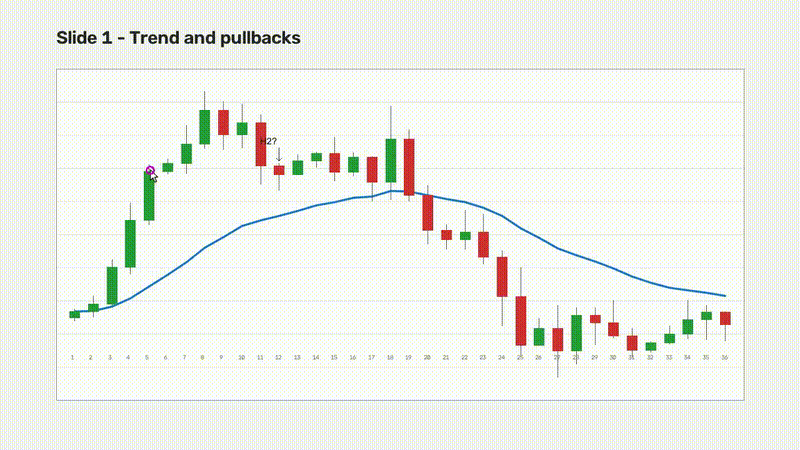
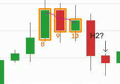
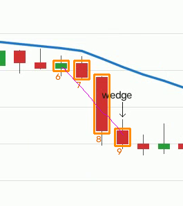
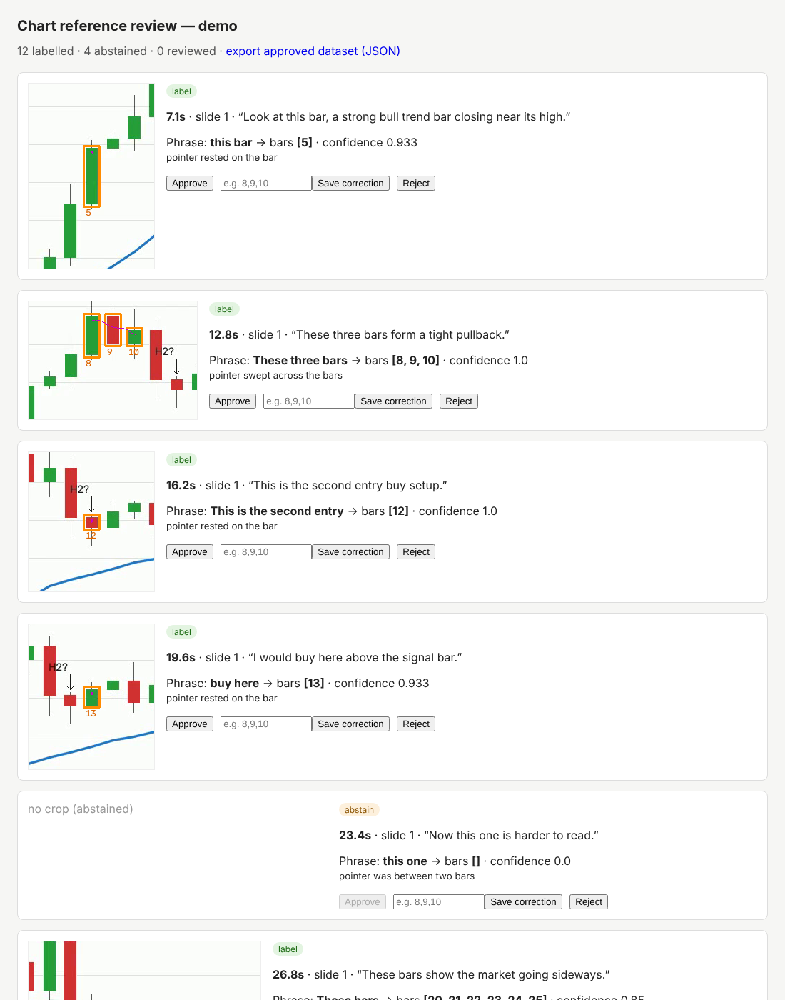

# chart-reference-labeller

[](https://github.com/AbdulkadirKhoujja/chart-reference-labeller/actions/workflows/python-tests.yml)

**Turns narrated chart-teaching videos into bar-level training examples: "this bar", "these three bars", "this wedge" → the exact candlesticks the instructor pointed at, or an explicit abstain when it isn't clear.**

Built as a working demonstration for converting trading-course videos into structured, machine-readable training data. Precision comes first: the pipeline only emits a label when the pointer clearly indicates the bars, and abstains with a stated reason otherwise.



> **Honest scope:** all footage here is **synthetic** (generated by `demo/generate.py`: random OHLC charts, a drawn mouse pointer and a scripted transcript) so every result can be scored against a known answer key. It has not yet been run on real course footage.

## What it does

1. **Frames and slides:** samples the video at 10 fps and splits it into slides when most of the frame changes at once (a moving pointer never triggers a cut).
2. **Clean chart image:** takes the per-pixel median of each slide, which removes the moving pointer and leaves the static chart.
3. **Chart and candlesticks:** finds the plot area and every candle body by colour, then assigns stable bar IDs left to right (bull/bear, x-range and body extent are recorded).
4. **Pointer tracking:** the pointer is the small blob that differs from the clean chart; its tip is tracked frame by frame.
5. **Transcript sync:** parses the SRT transcript and finds spoken references: *this/that/these/those* + bar, candle, breakout, pullback, entry, setup, trade, wedge, range, pattern…, counted forms ("these three bars"), and "buy/sell here".
6. **Resolution:**
   - Single references use where the pointer *rested* during the phrase.
   - Plural and region references ("these bars", "this wedge") use the bars the pointer *swept* across, and must match the spoken count.
   - **Abstains** when the pointer is off the chart, between two bars, never settles, rests in two places, or the count heard doesn't match.
7. **Output:** a Pydantic-validated `references.json`, one cropped image per label, and an annotated `preview.mp4`.
8. **Human review:** a small web page to approve, correct or reject each label; only reviewed examples are exported.

## Measured results (synthetic)

**Single lesson** (`examples/evaluation.json`): 2 slides, 72 bars detected (36 + 36), 20 transcript lines.

| Measure | Result |
|---|---|
| Precision (labels that were right) | **12 / 12 = 1.00** |
| Coverage (real references labelled) | **12 / 12 = 1.00** |
| Ambiguous moments correctly abstained | **4 / 4** |
| False labels | **0** |

**Stress test:** 10 freshly generated charts per setting, with an increasingly shaky hand while pointing (`stress_test.py`). Bar spacing is 30 px.

| Pointer shake | Labels emitted | Wrong labels | Precision | Coverage | Ambiguous abstained |
|---|---|---|---|---|---|
| ±1.5 px | 120 | 0 | **1.00** | 1.00 | 40 / 40 |
| ±5 px | 108 | 0 | **1.00** | 0.90 | 40 / 40 |
| ±9 px | 48 | 0 | **1.00** | 0.40 | 40 / 40 |

As pointing gets less clear, the system labels *less*, not *wrongly*. That is the intended trade-off when building training data.

## Example output record

```json
{
  "segment_index": 3, "slide": 1, "start_s": 12.8, "end_s": 15.4,
  "transcript": "These three bars form a tight pullback.",
  "phrase": "These three bars", "expected_count": 3,
  "decision": "label", "bar_ids": [8, 9, 10], "confidence": 1.0,
  "reason": "pointer swept across the bars",
  "pointer_on_chart_ratio": 1.0, "crop_path": "crops/seg003.png"
}
```

Abstained moments keep the transcript and the reason, e.g. `"pointer was between two bars"`, so they can be reviewed rather than silently dropped.

| Crop: "these three bars" | Crop: "this wedge" |
|---|---|
|  |  |

## Review page



```bash
python review/app.py outputs/demo      # http://127.0.0.1:5050
```

Approve, enter corrected bar IDs, or reject. Decisions save to `reviews.json`, and `/export` returns only approved or corrected examples.

## Run it

Create an isolated environment and install the original project dependencies first:

```bash
python -m venv .venv
# Activate .venv using your platform
python -m pip install -e .
```

The commands below use POSIX-style `PYTHONPATH=src`. On Windows PowerShell, run `$env:PYTHONPATH = "src"` first, or use the installed package without setting `PYTHONPATH`.


Requires Python 3.11+, `opencv-python`, `numpy`, `pydantic`, `flask`, and `ffmpeg` on PATH. The Python dependencies are declared in `pyproject.toml`; install `ffmpeg` separately.

```bash
python demo/generate.py --out demo/assets                    # synthetic lesson + answer key
PYTHONPATH=src python -m chartref.pipeline demo/assets/chart_lesson.mp4 demo/assets/chart_lesson.srt --out outputs/demo
python evaluate.py outputs/demo/references.json demo/assets/answer_key.json
python stress_test.py --seeds 10 --jitter 5
PYTHONPATH=src python -m unittest discover -s tests -v       # 14 tests
```

## Adapting to real course footage

- **Chart styles:** candle colours, plot-area detection and minimum body width are the main settings to tune per course.
- **Transcripts:** an existing SRT/VTT works directly. Word-level timestamps, if available, would narrow each phrase's time window further.
- **Measuring on real data:** hand-label a small sample of real references, run `evaluate.py`-style scoring, and set the confidence threshold to hit the precision target before processing the full library.
- **Not yet covered:** trend lines, arrows and on-chart text detection, and setups referenced only by name without pointing.

## Project layout

```
src/chartref/   vision.py (slides, chart, bars, pointer) · transcript.py · resolve.py · pipeline.py · models.py
demo/           generate.py (synthetic lessons with answer key)
review/         app.py (Flask review page)
evaluate.py · stress_test.py · tests/ · examples/ · docs/
```

MIT licensed.

## 90-second demonstration walkthrough

[Watch the official 90-second narrated walkthrough](docs/walkthrough_90s_captioned.mp4) or read the [narration script](docs/WALKTHROUGH_NARRATION.md). The video includes recorded voice-over audio and captions. Its original path is retained for existing proposal links. The demonstration uses synthetic footage and is not evidence of performance on real client videos.

## Continuous integration

GitHub Actions installs the declared project dependencies on Ubuntu 24.04 with Python 3.13, then runs the original unittest suite on pushes to `main`, pull requests and manual dispatches. The trading workflow also installs FFmpeg. The [25 October 2026 verified run](https://github.com/AbdulkadirKhoujja/chart-reference-labeller/actions/runs/40235653721) passed **14/14 tests** on commit `c1a79d71e4d735638db85a666eb2c2b5977d7895`. These are synthetic test and application checks, not validation on unfamiliar client footage or professional embroidery outputs.
